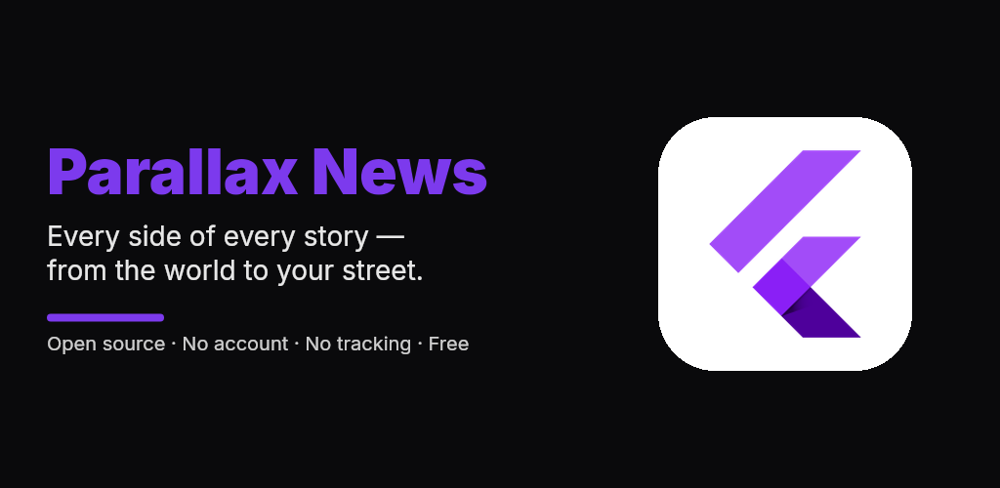

# Parallax News

**Every side of every story, from the world to your street.** Open-source, bias-aware news for Android. No account, no tracking, no server.

## Features

- **Global to hyper-local:** continents → countries → states → cities → neighbourhoods. It discovers real local papers, radio and TV for each place via Wikidata, with at least 10 outlets per place where they exist.
- **Left / center / right coverage** for every story, plus **blindspots** (stories one side ignores), with factuality, ownership and state-affiliation labels.
- **20 topics**, including Tech, AI, Science, Space, Sports, Gaming, Business and Climate, backed by about 390 seed outlets.
- **On-device curated daily feed:** a self-training topic classifier plus interest learning plus diversity ranking. It runs on low-end phones.
- **Home-screen widgets** for the Daily Briefing and Blindspot.
- **Auto-update:** checks at startup, downloads, and verifies the SHA-256 before installing.

## Build

CI (`.github/workflows/android.yml`) generates the Android project, runs analysis and tests, renders these images, and builds a signed APK on every push.

One-time setup:
1. Run `python tool/make_keystore.py` and back up `secrets/signing.keystore`.
2. Store it with `gh secret set ANDROID_KEYSTORE_B64 < secrets/signing.keystore.b64`.
3. Each push to `main` publishes a GitHub Release (APK + `latest.json`). Installed apps update from there automatically.

**Install:** download the APK from [Releases](https://github.com/JackLongman12/parallax-news/releases/latest) and allow "Install unknown apps" once.

## Contributing ratings

Edit `assets/sources.json`. Bias codes are `FL L LL C LR R FR`, relative to the outlet's country. Local outlets can be added on Wikidata, and the app picks them up automatically.

Data comes from Google News and Bing News RSS and Wikidata (CC0). The app shows headlines and links only. MIT licensed.
