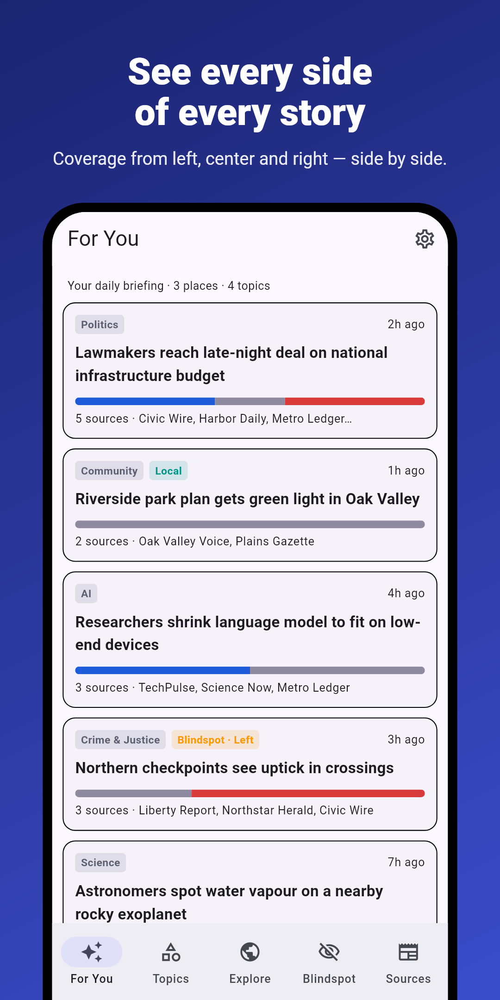
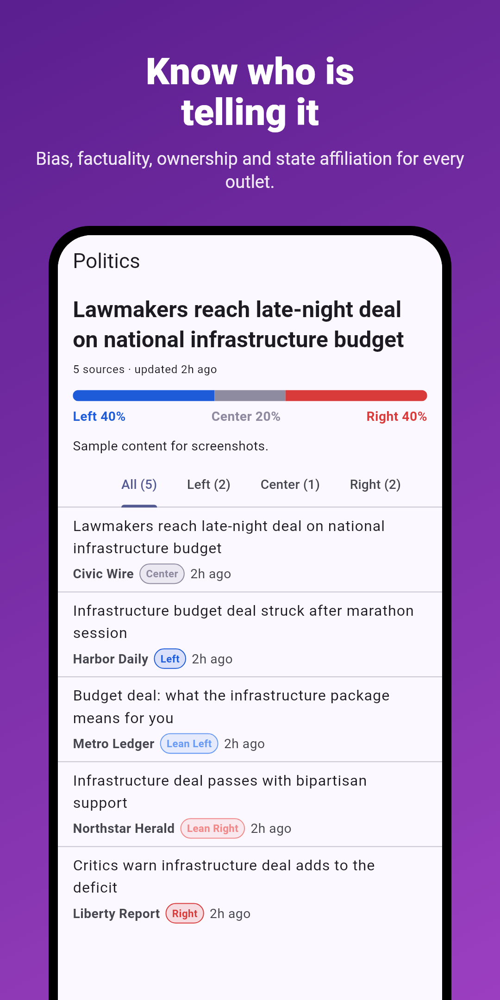
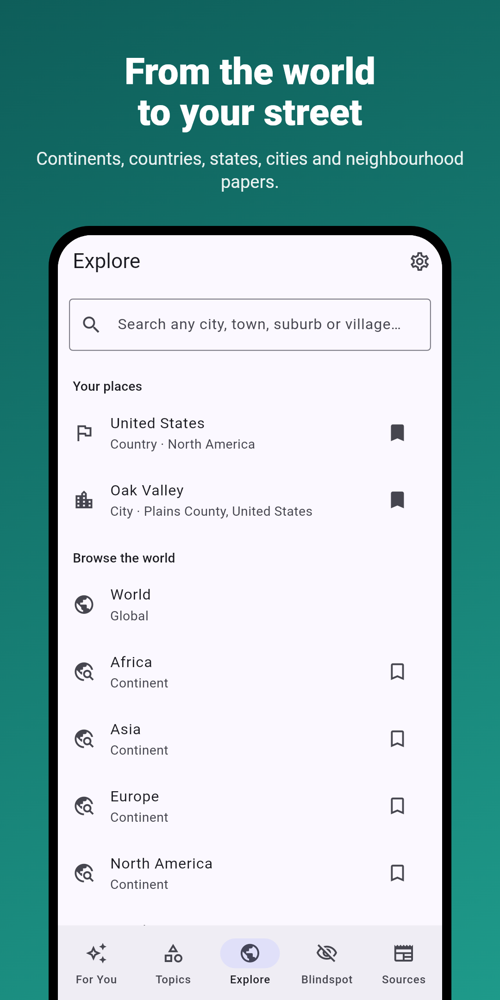
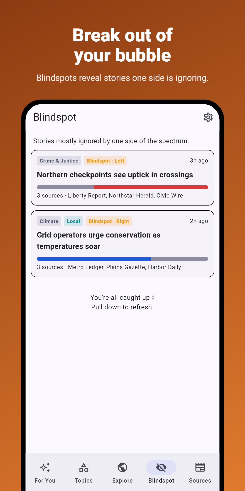
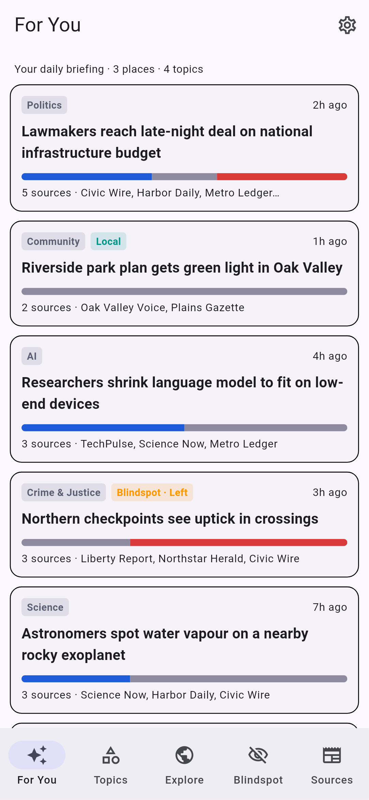
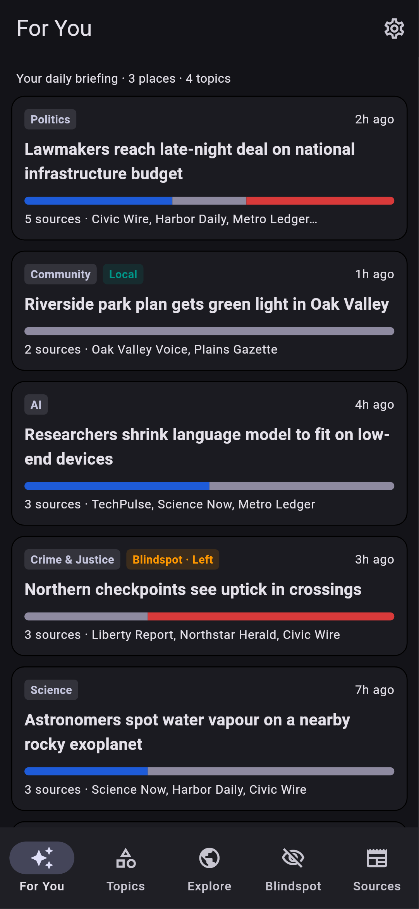
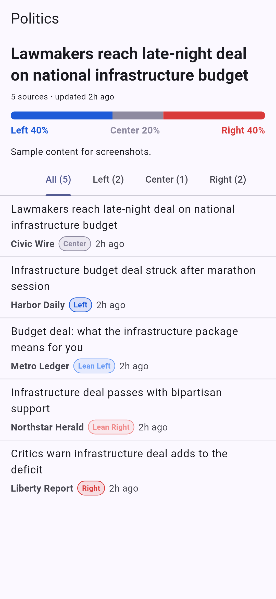
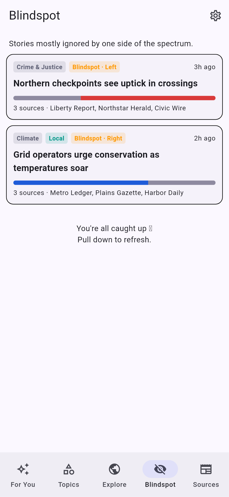
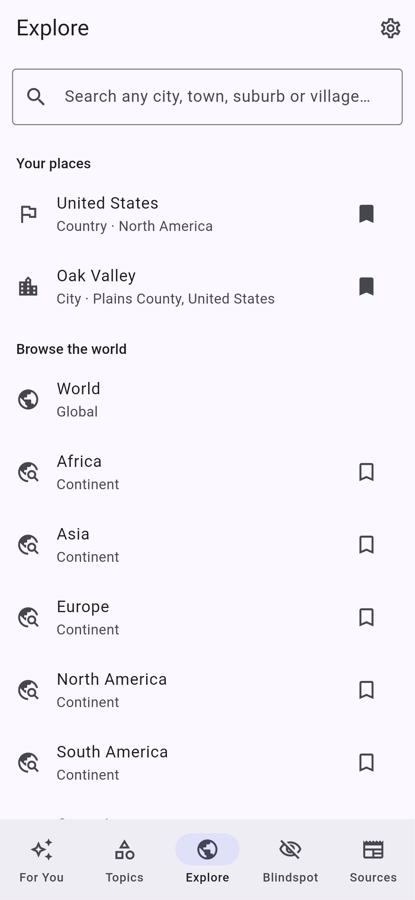
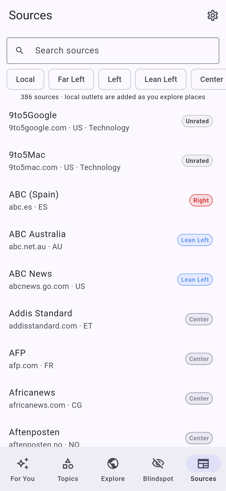

# Parallax News

Open-source, bias-aware news reader. It covers the whole world down to individual towns and neighbourhoods, and shows how each story is covered across the political spectrum. Android comes first. The Flutter codebase can also target Windows, macOS and web later.

  
  
  
  

### Screens

  
  
  
  
  
  

*Screenshots are rendered from the real widgets in CI (`screenshots/screenshot_test.dart`). The stories use fictional sample outlets.*

## What it does

- **World → continent → country → state/province → county → city → neighbourhood.** Use the browse view (Wikidata subdivisions) or search for any place (OpenStreetMap Nominatim).
- **Real local outlets, not just national wires.** For each place, the app asks Wikidata (CC0) which newspapers, radio and TV stations are published or based there. It then pulls each outlet's own RSS feed, or its latest items through Google News `site:` search. Google News local search and Bing News add more local coverage.
- **Political lean of every source.** Ratings come from:
  1. your own override, then
  2. the bundled community catalog (`assets/sources.json`, about 390 outlets across every continent plus topic specialists), then
  3. Wikidata political alignment or ideology, fetched live.

  Otherwise the source shows as *Unrated*. The app also shows factuality, owner and state affiliation.
- **Story clustering.** Headlines about the same event from different outlets are grouped into one story. Each story has a left/center/right coverage bar and a source list per side.
- **Blindspots.** Stories covered mostly by one side.
- **Topics.** Tech, AI, Science, Space, Health, Sports, Entertainment, Gaming, Markets & Crypto, Climate, Crime & Justice, Education, Autos, Travel & Food, Lifestyle, Politics, World and Community.
- **Daily curated feed ("For You"), fully on-device:**
  - A Naive Bayes topic classifier trains itself on labelled topic feeds every refresh. It takes microseconds per headline and runs fine on low-end phones.
  - A keyword lexicon covers day one.
  - An interest profile learns from the stories you open and decays daily.
  - A diversity re-ranker stops one topic flooding the feed and slightly favours stories covered across the spectrum.
  - Infinite scroll continues into topics you don't follow yet, then stops at "You're all caught up".
- **Lite mode** for weak phones and slow data: no images, fewer parallel requests.
- **Auto-update.** At startup the app checks `latest.json`, downloads the newer APK with SHA-256 verification, and opens Android's installer.

## No server needed

All fetching and processing happens on the phone, so there is no backend and no cost. The only thing that must be public is where update APKs are downloaded from. The repo is private and anonymous apps can't read private releases, so CI publishes builds to a separate public repo, `parallax-news-releases`, which holds only the APK and `latest.json`. GitHub Releases are free with no bandwidth cap.

Optional later, free tier: a Cloudflare Worker (100k requests/day) acting as a CORS proxy for a web version, and/or a shared feed cache.

## Build & release pipeline

`.github/workflows/android.yml` runs on every push to `main`:

1. `flutter create` (Android platform files are generated, not committed), then `tool/prepare_android.py`, which adds permissions, the installer FileProvider, no cleartext traffic and no adb backup.
2. `flutter analyze` and `flutter test`.
3. Builds a release APK signed with the stable key from the `ANDROID_KEYSTORE_B64` secret.
4. Uploads the APK as a workflow artifact and, if `RELEASES_TOKEN` is set, publishes it to the public releases repo.

### One-time setup

- `python tool/make_keystore.py` creates `secrets/signing.keystore`. **Back it up.** If you lose it, existing installs can't be updated.
- `gh secret set ANDROID_KEYSTORE_B64 < secrets/signing.keystore.b64`
- Create a public repo named `parallax-news-releases`. Then create a fine-grained token with *Contents: read & write* on that repo only, and store it with `gh secret set RELEASES_TOKEN`.
- Install the first APK by hand (allow "Install unknown apps"). Later builds update themselves.

## Contributing ratings

Edit `assets/sources.json`. Bias codes are `FL L LL C LR R FR`, relative to the outlet's own country. Factuality codes are `VH H MF M L`. `s:true` means state-affiliated. `t` lists topic specialisms and `rss` is a direct feed. The seed ratings are a starting point and need review. Local outlets can also be added on Wikidata (instance of newspaper / radio station / TV station, with *place of publication* and *official website*), and the app picks them up automatically.

## Data sources & terms

Google News RSS and Bing News RSS (unofficial public feeds), GDELT, Wikidata (CC0) and OpenStreetMap Nominatim (1 request/second, attribution). The app shows headlines and links to publishers. It never copies article bodies.

License: MIT.
